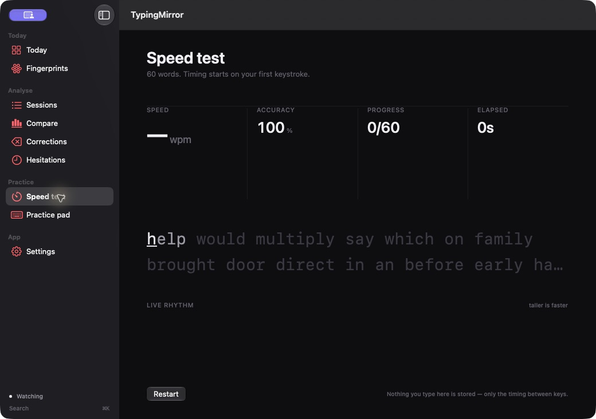

# TypingMirror

A macOS app for seeing your typing habits.

## Description

TypingMirror shows your pauses, bursts and corrections alongside typing speed.
Try the speed test or practice pad, or record typing in other apps to compare
coding, writing and messaging.

Replay saved sessions, see where you backspace, and get a daily fingerprint
from your typing stats.

### Screenshots



### Privacy

By default, only timing and key types are saved, not your text. Capture in other
apps is off by default, pauses during macOS Secure Input, and excludes password
managers, Messages and Mail.

Everything stays on your Mac. There is no account or sync, and capture runs only
while the app is open.

**Rhythm and words** is an optional mode for tracking hesitation on test words.
It stores words and requires typing `ALLOW` to enable it. Credential-like words
are filtered out. Expired words are cleared at startup after a default 14-day
retention window. Disable the mode to clear all words, or inspect and delete
them in Settings.

## Getting Started

### Dependencies

- macOS 26.0 or later
- Xcode 27
- [XcodeGen](https://github.com/yonaskolb/XcodeGen)

### Installing

Clone the repository, install XcodeGen and generate the project:

```bash
git clone https://github.com/mastercoder26/TypingMirror.git
cd TypingMirror
brew install xcodegen
xcodegen generate
```

### Executing program

Open `TypingMirror.xcodeproj` in Xcode, select the `TypingMirror` scheme and run it.

Or build and launch from the terminal:

```bash
xcodebuild -project TypingMirror.xcodeproj -scheme TypingMirror \
  -configuration Debug -destination 'platform=macOS,arch=arm64' \
  -derivedDataPath build build
open build/Build/Products/Debug/TypingMirror.app
```

**Speed test** and **Practice pad** work without extra permissions. For capture
elsewhere, enable **Watch typing in other apps** in Settings and grant Input
Monitoring permission. Use `⌘K` to jump between screens.

### Tests

From the repository root:

```bash
cd Packages/TypingMirrorKit
swift test
```

The SwiftUI app lives in `Sources/`. Capture, metrics, storage and replay live in
`Packages/TypingMirrorKit/`; its core tests run without launching the app.

## Help

If capture stops, check **System Settings → Privacy & Security → Input
Monitoring** and the capture status in Settings. Permission may need to be
granted again after a rebuild.

The app runs without App Sandbox because global keyboard capture requires it.

For other problems, [open an issue](https://github.com/mastercoder26/TypingMirror/issues)
with steps to reproduce it.

## License

This repository does not yet contain a license file.
